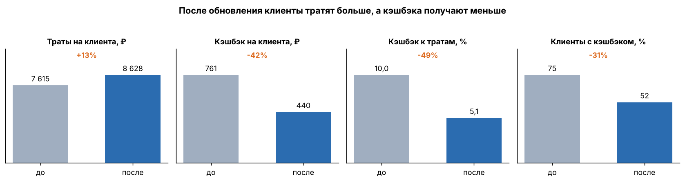
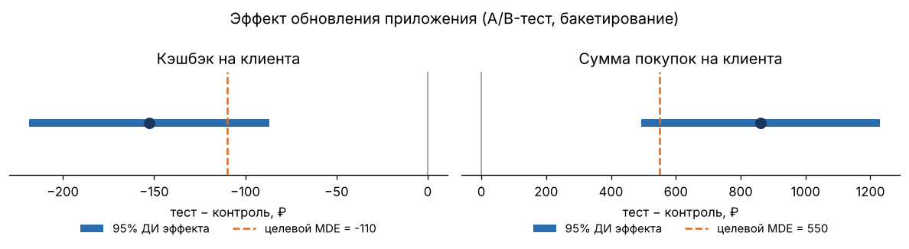
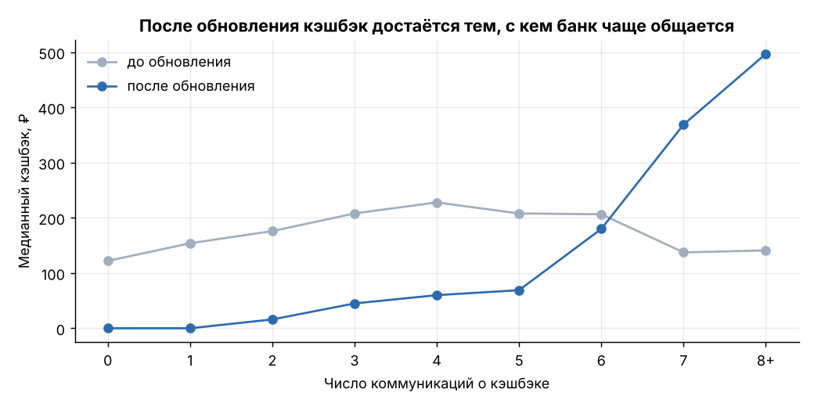
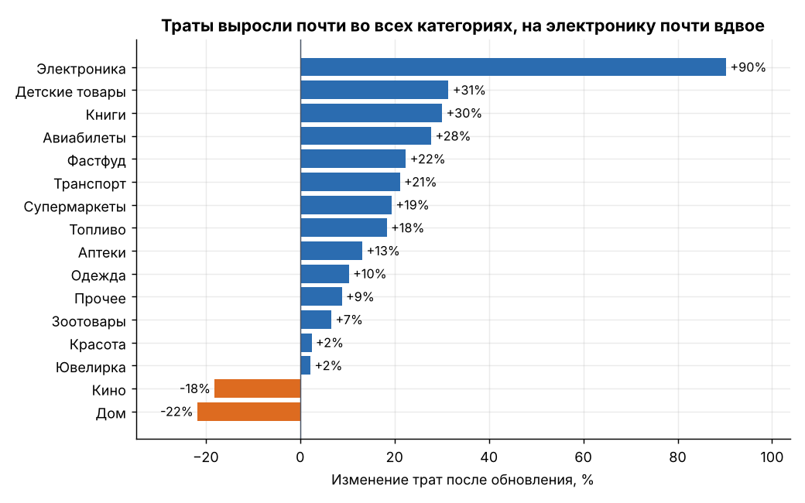

# Как обновление приложения повлияло на кэшбэк-программу банка

Командный учебный кейс (5 человек) по анализу данных, 3 курс СПбГЭУ.

[English version below](#english)

## Задача

Банк обновил приложение и способ, которым он рассказывает клиентам о кэшбэк-предложениях. Нужно было понять:
1. Связаны ли коммуникации о кэшбэке с тем, сколько кэшбэка получает клиент?
2. Связаны ли траты клиента с кэшбэком?
3. Как обновление повлияло на траты и кэшбэк?

Данные: 50 тыс. клиентов за 2022 год. По каждому известен кэшбэк от банка и от партнёров, число коммуникаций, просмотров и активаций предложений, траты по 16 категориям до обновления и после.

## Главное

**Клиенты стали тратить больше, а кэшбэк банку стал обходиться дешевле.** Траты на клиента выросли на 13%, а доля трат, которая возвращается кэшбэком, упала с 10% до 5%. Кэшбэк теперь получает только половина клиентов, раньше его получали три четверти. Доля кэшбэка, которую оплачивают партнёры, выросла с 61% до 69%.

A/B-тест на бакетах подтвердил, что оба эффекта статистически значимы (p < 0,001), и оценил их размер:

**Кэшбэк стал зависеть от коммуникаций.** До обновления медианный кэшбэк почти не менялся с числом сообщений. После обновления клиенты, с которыми банк связывался 0–1 раз, кэшбэка почти не получают, а у тех, кому писали 7 и более раз, медиана выросла до 370–500 ₽. Корреляция Спирмена между числом коммуникаций и кэшбэком выросла с 0,11 до 0,48.

**Рост трат широкий, а не за счёт одной категории.** Траты выросли в 14 категориях из 16. Сильнее всего на электронику (+90%), детские товары и книги (около +30%). Упали только траты на дом и кино.

**Что это значит для банка.** Обновление сработало как точечная программа лояльности: банк меньше платит «всем подряд» и больше тем, кого активно вовлекает. Дальше стоит проверить, не уходят ли клиенты, которые перестали получать кэшбэк, и считать эффект на выручку банка, а не только на траты.

## Как проверял

- Распределения сильно скошены, поэтому корреляции считал по Спирмену.
- Для теста рассчитал размер выборки (α = 0,05, мощность 0,8, целевой MDE).
- A/A-тест на 1000 симуляций: доля ложных срабатываний 4,6% при ожидаемых 5%, p-value распределены равномерно (тест Колмогорова–Смирнова). Значит, разбиение на группы корректное.
- Данные ненормальные, поэтому сравнивал средние по бакетам из 30 наблюдений t-тестом для независимых выборок. Отдельно проверил, что эффект не меньше заданного MDE.

## Ограничения

Это сравнение «до/после», а не настоящий рандомизированный эксперимент: группы собраны из одних и тех же клиентов в разные периоды. Периоды ещё и разной длины, поэтому я опираюсь на метрики-отношения (кэшбэк к тратам, доля клиентов с кэшбэком): они от длины периода не зависят. Для более строгой оценки подошли бы difference-in-differences или CUPED.

## Файлы

- `notebooks/cashback_analysis.ipynb`: весь анализ.
- `scripts/make_figures.py`: графики для этого README.
- `data/cashback.csv`: данные кейса.

Python, pandas, SciPy, matplotlib, seaborn.

---

## English

**How an app update changed a bank's cashback programme.** This was a university team case study with 50k customers.

After the update, spending per customer rose 13% while the share of spending returned as cashback halved, from 10% to 5%. Only half of customers now receive cashback, compared with three quarters before. A bucketed A/B test confirms both effects (p < 0.001). Cashback became strongly tied to how often the bank contacts a customer: Spearman's ρ rose from 0.11 to 0.48. Spending grew in 14 of 16 categories, led by electronics (+90%).

Because this is a before/after comparison with periods of different length, I rely on ratio metrics. Difference-in-differences or CUPED would be the next step.
