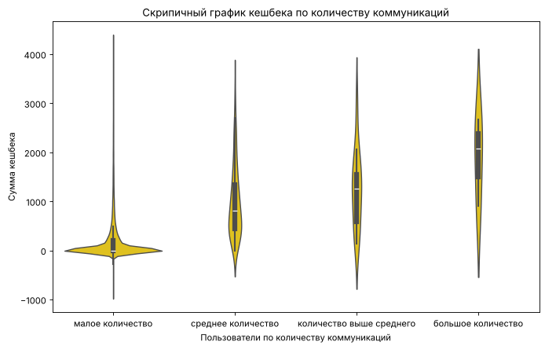

# Эффект обновления кэшбэк-программы банка: корреляции и A/B-тест

🇷🇺 Русский · [🇬🇧 English](#-english)

**Задача.** Банк обновил приложение и механику коммуникаций с клиентами о кэшбэке. Нужно понять, как коммуникации и обороты клиентов связаны с выплаченным кэшбэком, и оценить, повлияло ли обновление на ключевые метрики.

**Данные.** ~44 тыс. клиентов, 2022 год: кэшбэк от банка и партнёров, число коммуникаций, просмотров и активаций предложений, траты по 17 категориям — до и после обновления.

**Формат.** Учебный командный кейс (5 человек), курс «Анализ данных», 3 курс.


## Что сделано

1. **Корреляционный анализ** (Спирмен, т.к. распределения сильно скошены) с сегментацией клиентов по числу коммуникаций и сумме выплат: boxplot и violin plot по сегментам.
2. **Дизайн эксперимента:** расчёт необходимого объёма выборки по α = 0,05, β = 0,2 и целевому MDE.
3. **A/A-тест:** 1000 симуляций, проверка, что доля ложноположительных результатов ≈ 5% и p-value распределены равномерно (критерий Колмогорова–Смирнова).
4. **A/B-тест:** распределения ненормальные, поэтому применено **бакетирование** (средние по бакетам из 30 наблюдений), затем t-тест для независимых выборок и проверка, что эффект не меньше целевого MDE (z-тест и доверительный интервал).

## Ключевые результаты

| Метрика | Эффект (тест − контроль), 95% ДИ | p-value | Вывод |
|---|---|---|---|
| Кэшбэк на клиента | от −218 до −87 ₽ | < 0,001 | Выплаты кэшбэка снизились |
| Сумма покупок на клиента | от +493 до +1229 ₽ | < 0,001 | Траты клиентов выросли |

- Связь числа коммуникаций с кэшбэком после обновления усилилась: ρ Спирмена выросла с 0,11 до 0,48.
- Корреляция оборота клиента с кэшбэком умеренная (ρ ≈ 0,32–0,37): кэшбэк получают не со всех покупок.
- **Итог для бизнеса:** обновление одновременно увеличило траты клиентов и снизило расходы банка на кэшбэк.



## Ограничения и что бы я улучшил

- Это квази-эксперимент «до/после», а не рандомизированный A/B: группы собраны из одних и тех же клиентов в разные периоды, а периоды «до» (янв–авг) и «после» (3 месяца) разной длины. Метрики стоит нормировать на месяц, а для оценки эффекта лучше подошли бы difference-in-differences или CUPED.
- Вместо бакетирования можно применить bootstrap и тест Манна–Уитни и сравнить выводы.

## Стек

Python · pandas · NumPy · SciPy · seaborn · matplotlib

## Как запустить

```bash
pip install pandas numpy scipy seaborn matplotlib jupyter
jupyter notebook notebooks/cashback_analysis.ipynb
```

---

## 🇬🇧 English

**Bank cashback programme: correlation analysis and A/B test of an app update**

**Problem.** A bank updated its app and the way it notifies customers about cashback offers. The goal was to measure how notifications and customer spending relate to cashback paid out, and whether the update changed the key metrics.

**Data.** ~44k customers, 2022: bank and partner cashback, number of notifications, views and activations, and spending in 17 categories before and after the update. University team case study (5 people).

**What was done**
- Spearman correlation analysis with customer segmentation (box and violin plots).
- Sample-size calculation (α = 0.05, power = 0.8, target MDE).
- A/A test, 1,000 simulations: false-positive rate ≈ 5%, uniform p-values (KS test).
- A/B test with bucketing (non-normal data), two-sample t-test for independent samples, and an MDE check via z-test and confidence interval.

**Results**
- Cashback per customer: −218 to −87 RUB (95% CI); spending per customer: +493 to +1,229 RUB (95% CI); both p < 0.001.
- The correlation between notifications and cashback rose from ρ = 0.11 to 0.48 after the update.
- Business takeaway: the update increased customer spending while lowering the bank's cashback costs.

**Limitations.** This is a pre/post quasi-experiment with periods of different length. Next steps would be per-month normalisation and difference-in-differences or CUPED.

**Stack:** Python, pandas, NumPy, SciPy, seaborn, matplotlib.
